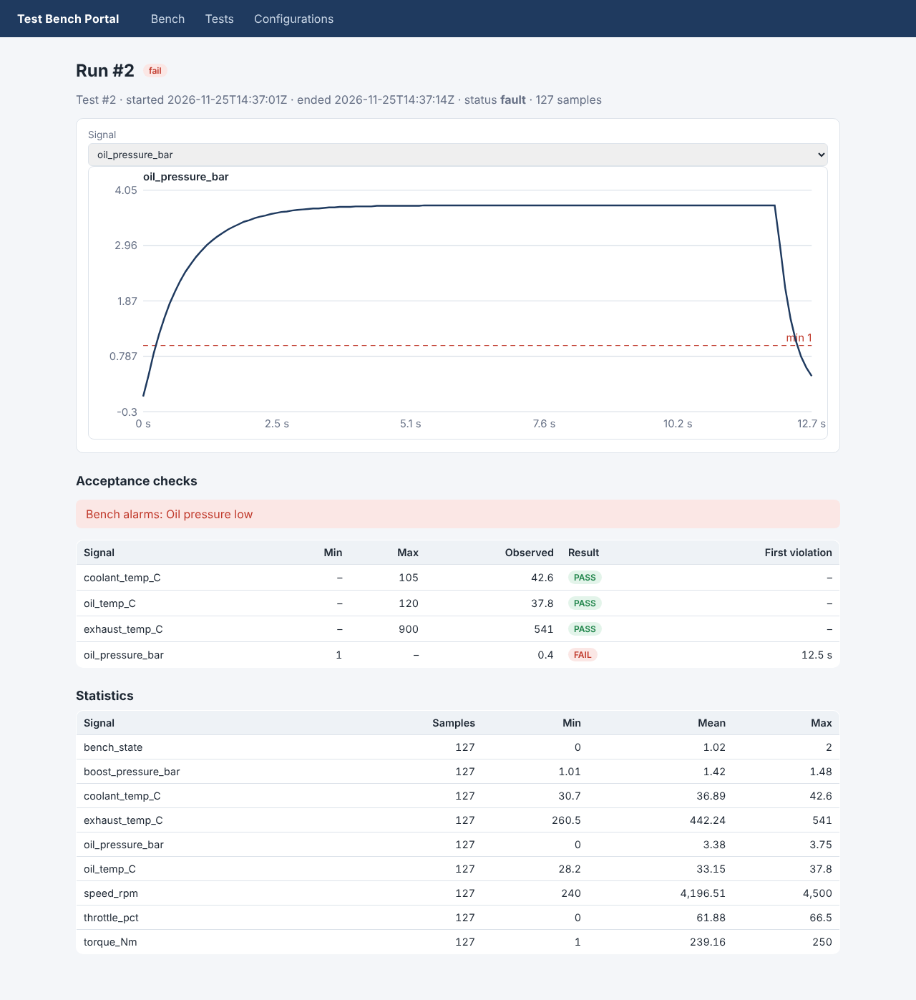
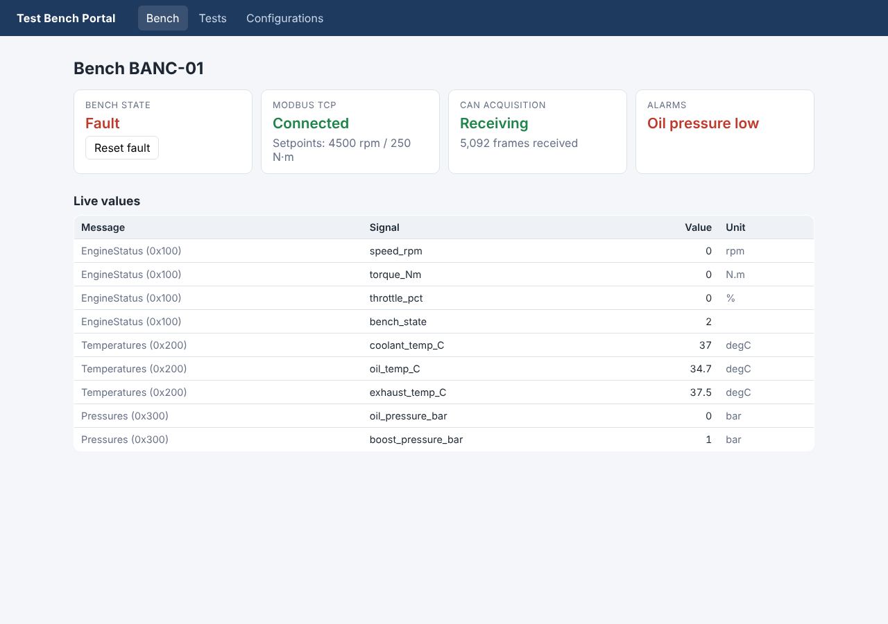
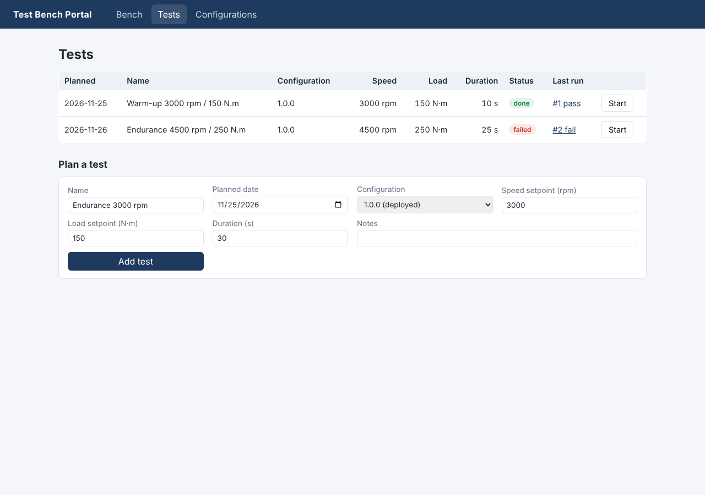
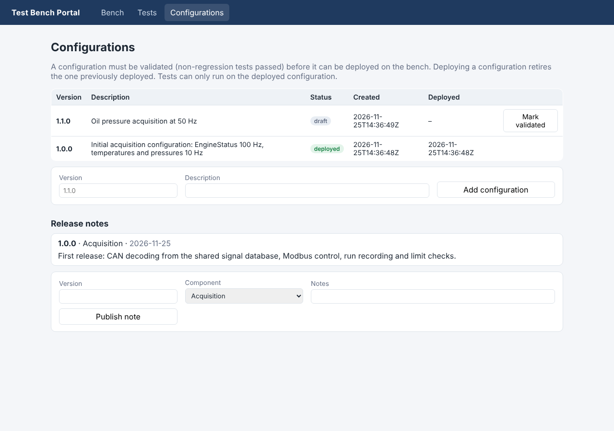

# Test Bench Platform

A small, complete software chain for an engine test bench, built as a personal project:

- **bench-sim** (C++17): a simulated engine on a dynamometer. It publishes its measurements as
  **CAN** frames and exposes its setpoints, commands and status over **Modbus TCP**.
- **acquisition** (C# / .NET 8): drives the bench over Modbus, decodes the CAN frames, records
  each test run in a **SQL** database (SQLite), checks acceptance limits and exposes a REST API.
- **portal** (Angular): the test management portal: live supervision, test planning,
  run results with plots, configuration lifecycle and release notes.

The bench is simulated, so the whole chain runs on a laptop and in CI. Replacing the simulator
with a real bench controller only requires the same CAN and Modbus interfaces
([docs/interfaces.md](docs/interfaces.md)).



## What the chain does

1. An engineer plans a test in the portal (speed and load setpoints, duration) on the
   **deployed** bench configuration.
2. Starting it, the acquisition service checks that the bench is reachable and not in fault,
   writes the setpoints over Modbus, and sends the start command.
3. During the run, CAN frames are decoded with the shared signal database and recorded at 10 Hz;
   the bench state and alarms are supervised over Modbus every 500 ms.
4. The run ends at the planned duration, on operator stop, or when the bench trips (for example
   on low oil pressure). Statistics and acceptance checks are computed and a pass/fail verdict
   is stored.
5. The portal shows the verdict, the failed checks with the time of the first violation, and the
   recorded signals.

| Bench supervision | Test planning |
|---|---|
|  |  |

Configurations follow a **draft → validated → deployed** lifecycle (a configuration must pass
its validation before deployment, and tests only run on the deployed one), with release notes
for each version.



## Tests

| Level | What is checked | Command |
|---|---|---|
| C++ unit tests | signal packing (sign, saturation), CAN/UDP format, engine dynamics, fault trip, Modbus request handling and exceptions | `ctest --test-dir bench-sim/build` |
| C# unit tests | CAN decoding (same vectors as C++), Modbus client against an in-process server, run recording, fault and stop handling, configuration lifecycle, SQL decimation | `dotnet test acquisition` |
| End-to-end non-regression | simulator + API over real sockets: nominal run passes; injected oil pump failure trips the bench, fails the run and reports the alarm | `scripts/integration_test.sh` |

All of them run in GitHub Actions on every push. The end-to-end test found a real bug during
development: after the bench controller restarted, the Modbus client kept a dead connection.
The client now reconnects once on a dropped connection.

## Getting started

Requirements: a C++17 compiler and CMake, the .NET 8 SDK, Node.js 22.

```bash
scripts/run_demo.sh            # builds everything, starts the simulator and the portal
# open http://localhost:5080
```

Inject a failure to see a fault run:

```bash
scripts/run_demo.sh --fail-oil-pump-at 20
```

Components separately:

```bash
cmake -S bench-sim -B bench-sim/build && cmake --build bench-sim/build
bench-sim/build/bench_sim --modbus-port 1502 --can-port 20000
dotnet run --project acquisition/src/BenchPortal.Api
cd portal && npm ci && npx ng serve    # dev server on :4200, API proxied
```

## Repository layout

```
bench-sim/        C++ simulator: engine model, CAN packing, Modbus TCP server, unit tests
acquisition/      C# solution: CAN receiver, Modbus client, acquisition service, SQL storage, REST API, xUnit tests
portal/           Angular portal
config/           shared CAN signal database and acceptance limits
scripts/          demo and end-to-end non-regression scripts
docs/             interfaces (CAN, Modbus, API) and screenshots
```

## Limits and next steps

- CAN travels over UDP so the project runs without hardware; the next step is a SocketCAN
  (`vcan`/`can0`) transport and a reader for real `.dbc` files.
- Modbus support is limited to functions 03 and 06.
- The engine model is a set of first-order dynamics, meant to exercise the software, not to
  represent a real engine. A model generated from Simulink could replace it.

## About

Personal project by Sarah Gbala Sapoulou, built with [Claude Code](https://claude.com/claude-code).
